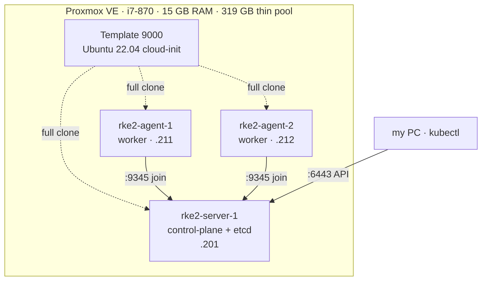

# homelab

**[English](#english) | [Português](#português)**

My home Kubernetes lab: one old desktop running Proxmox, three VMs, a cluster that started as K3s built with Terraform and is now RKE2 installed by hand. This repo is the code, the install guide and, mostly, the things that broke.



---

## English

### Timeline

| When | What |
|---|---|
| May 2026 | K3s cluster created with Terraform on Proxmox ([`terraform-k3s-legacy/`](terraform-k3s-legacy/)) |
| Jul 31 | Changed ISP. New router, new subnet. The cluster lost its network |
| Sep 7 | Network fixed by hand, cluster healthy again |
| Sep 10 | Rebuilt as **RKE2** v1.36, installed manually as practice ([`rke2/`](rke2/)) |
| Oct 2 | Old K3s VMs and snapshots destroyed, ~126 GB freed |

### Things that broke (and what they taught me)

**1. The ISP changed the subnet and the cluster slowly died.**
The new router used `192.168.86.0/24`; the VMs had static IPs and a gateway in the old `192.168.15.0/24`. They lost internet for about five weeks. CoreDNS had no upstream, so its readiness probe returned 503, the liveness probe kept killing it, and it piled up **141 restarts**. Fixed with netplan (new gateway and DNS).
*Lesson:* `node-ip` is baked into certificates and etcd. Plan the addressing once, and read the existing config before theorizing.

**2. `Fatal glibc error: CPU does not support x86-64-v2` on RKE2.**
The Canal CNI init container crashed on every node. The VMs cloned for RKE2 had inherited `cpu: kvm64`, a generic QEMU model that hides SSE4.2/POPCNT. The Terraform-built K3s VMs used `cpu: host`, which is why they never had the problem.
Fix: `qm set <vmid> --cpu host`, then **stop/start** (a reboot is not enough: the QEMU process must be recreated).
*Lesson:* when cloning from the template, always set `--cpu host`.

**3. Two workers with the same IP.**
The agent config was copied from agent-1 to agent-2 without changing `node-ip`. Fixing the file was not enough, because the old IP stays recorded in the Node object. Fix: correct the file, restart `rke2-agent`, then `kubectl delete node rke2-agent-2` so it registers again.

### Repo layout

```
rke2/                    install guide + config templates (current cluster)
terraform-k3s-legacy/    Terraform that built the first K3s version (retired)
```

### Next

- Turn the RKE2 install into an Ansible playbook, so the cluster can be rebuilt from code.
- GitOps (Flux) for what runs on it.

---

## Português

Meu laboratório Kubernetes em casa: um PC antigo rodando Proxmox, três VMs e um cluster que começou como K3s criado com Terraform e hoje é RKE2 instalado à mão. Aqui estão o código, o roteiro de instalação e, principalmente, o que quebrou no caminho.

### O que quebrou (e o que ensinou)

1. **Troquei de provedor, a sub-rede mudou e o cluster morreu aos poucos.** As VMs ficaram ~5 semanas sem internet, o CoreDNS ficou sem DNS de saída e acumulou 141 restarts. Corrigido no netplan. Lição: o `node-ip` vai parar nos certificados e no etcd; endereçamento se planeja uma vez só.
2. **`CPU does not support x86-64-v2` no RKE2.** As VMs clonadas herdaram `cpu: kvm64`, que esconde instruções da CPU real. As do Terraform usavam `cpu: host`. Correção: `--cpu host` + desligar e ligar a VM (reboot não basta).
3. **Dois workers com o mesmo IP.** Config copiada sem trocar o `node-ip`. Além de corrigir o arquivo, foi preciso apagar o Node no cluster pra ele se registrar de novo.

Roteiro de instalação em [`rke2/`](rke2/) e o Terraform da primeira versão em [`terraform-k3s-legacy/`](terraform-k3s-legacy/).

## License

[MIT](LICENSE)
